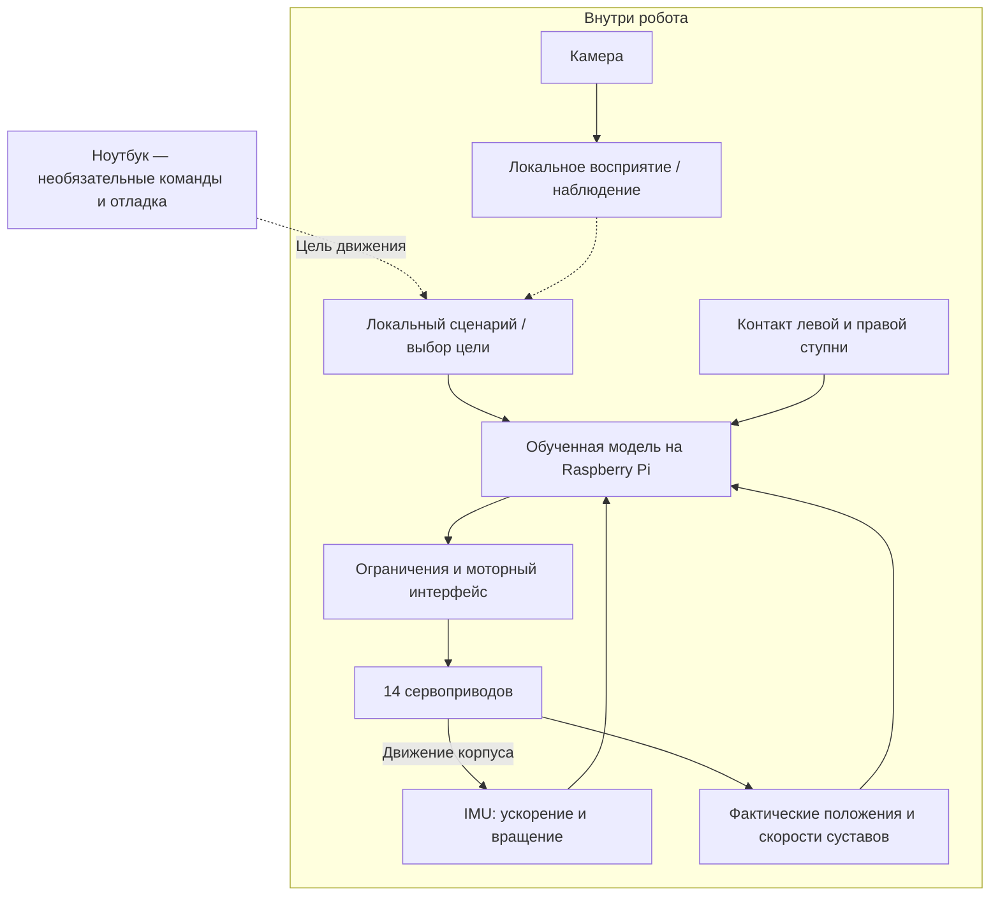

# Основная версия: робот около 40 см с бортовой моделью движения

**Дата: 26 октября 2026. Статус: рекомендуемая архитектура для проектирования и проверки, не готовая корзина и не испытанная сборка.**

## 1. Какой робот предлагается

Двуногая платформа на механической основе **Open Duck Mini v2**: примерно 42 см с выпрямленными ногами. Сохраняются исходная кинематика и 14 управляемых суставов. Собственный внешний облик создаётся преимущественно лёгкими оболочками и облицовкой, с проверкой массы и центра тяжести.

Основной компьютер, обученная двигательная модель, обработка датчиков и цикл команд приводам находятся **внутри робота**. Ноутбук необязателен при выполнении локального сценария: он используется для обучения/отладки и может передавать цели, например «идти», «повернуться», «остановиться».

Механическая основа и CAD: [Open Duck Mini v2](https://github.com/apirrone/Open_Duck_Mini/tree/v2). Это отдельный проект, не Microduck за 399 долларов. Шестисервовый эскиз на 20 см остаётся ранним эстетическим ориентиром; его размеры, приводы, походка и смета к этой версии не переносятся.

## 2. Основные детали

| Узел | Предлагаемый вариант | Количество | Назначение / статус |
|---|---|---:|---|
| Приводы | **Feetech STS3215-C001, 7,4 В, 19,5 кгс·см stall, редуктор 1:345** | **14** | Штатный класс привода донора; команды и чтение обратной связи по последовательной TTL-шине. Не заменять на C0461:147 или 12-вольтовый вариант |
| Бортовой компьютер | **Raspberry Pi 4 Model B, 2 ГБ** | 1 | Linux, локальный ONNX-инференс, датчики, связь и камера. Предлагаемое расширение донора; его массу, питание и установку runtime нужно проверить |
| Носитель | **microSD32 ГБ**, качественная карта | 1 | ОС, программа и веса модели |
| Интерфейс моторов | **Waveshare Bus Servo Adapter A** | 1 | Связь USB компьютера с полудуплексной TTL-шиной серв |
| IMU | **BNO055 breakout**, совместимый с I²C3,3 В Pi | 1 | Ускорение и вращение корпуса; тип датчика совпадает с текущим runtime донора |
| Контакты ступней | **Микропереключатели SS-10 по BOM/механике донора** | 4 физических контакта | В текущем ПО представлены двумя каналами контакта — левая и правая ступня; схему объединения сохранять по исходной проводке |
| Камера | **Raspberry Pi Camera Module2 / IMX219**, полный модуль | 1 | Наблюдение, запись/передача изображения, последующая локальная обработка. Самой политике ходьбы пиксели камеры не требуются |
| Кабель камеры | **CSI15→15pin**, длина по трассировке | 1 | Для Pi 4 используется стандартный разъём камеры; старый кабель PiZero15→22pin не переносится автоматически |
| Механика | Исходные детали ног, стоп, рамы и 14 осевых креплений Open Duck v2 + свои лёгкие оболочки | 1 комплект | Начать с исходных длин звеньев и осей; геометрические изменения потребуют обновления симуляции и, возможно, обучения |
| Силовая часть | Аккумулятор, защита, моторная и логическая линии питания, силовой размыкатель, распределение | 1 система | Ниже задан согласованный кандидат; окончательные номиналы по испытанию |
| Зарядка | **SkyRC B6neo** или другой подходящий балансирный зарядник с сетевым источником | 1 внешний комплект | Соответствует выбранной батарее; не находится внутри робота |
| Сборка | Штатные качалки/центральные винты, подшипники, вставки, проводка, разъёмы, подошвы, крепёж | по CAD/BOM | Физически необходимая часть конструкции; точная деталировка после фиксации компонентов |

**Распределение 14 осей:** по 5 в каждой ноге (бедро yaw/roll/pitch, колено, голеностоп) и 4 в шее/голове. Четыре оси головы сохраняются для близости к исходной 14-суставной модели, а не потому, что произвольному роботу всегда требуется именно столько. Сокращение их до 2 — отдельная механическая/модельная адаптация.

Обычные PWM-сервы FT1017M/FT1190M/FS90 и XIAO Sense из раннего списка не являются основой этой версии. Дополнительная ESP32 для управления этими шинами первоначально не требуется: у серв есть внутреннее регулирование, а бортовой Pi выполняет внешний цикл.

## 3. Что принципиально изменилось в приводах

Для этой версии нужен доступ к **фактическим положениям и скоростям суставов**. STS3215 также допускает чтение напряжения, температуры и других значений состояния. Параметр «load» не следует считать точным измерением силы/момента в суставе.

Это позволяет двигательной модели получать реальные наблюдения вместо подстановки ранее отправленных целевых углов. Характеристики и варианты: [Feetech](https://www.feetechrc.com/20210430-56680.html), [Waveshare ST3215](https://docs.waveshare.com/ST3215_Servo).

Момент 19,5 кгс·см — stall при 7,4 В, не допустимая непрерывная нагрузка. Подбор и проверка привода продолжают зависеть от массы, рычагов, скорости и нагрева.

## 4. Где работает модель

Бортовая программа читает датчики и суставы, вычисляет действие моделью и отправляет цели приводам. В исходном скрипте задан цикл 50 Гц. Камера/сеть обрабатываются так, чтобы не блокировать двигательный цикл. Ноутбук не вычисляет обязательный следующий моторный такт.

В автономном режиме цели поступают из локального сценария. В режиме внешнего пульта они приходят с ноутбука; потеря связи обрабатывается локально. Обучение модели на внешнем компьютере и исполнение весов внутри робота — разные этапы.

**Готовая исходная политика есть у проекта-донора.** Её можно использовать как отправную точку при близкой механике/настройках, а не выдавать за уже проверенную политику нашей модификации. Длины, массы, моторные параметры, наблюдения, нормализация и порядок суставов должны соответствовать модели.

Источники: [Runtime](https://github.com/apirrone/Open_Duck_Mini_Runtime/tree/v2), [фактический цикл управления](https://github.com/apirrone/Open_Duck_Mini_Runtime/blob/v2/scripts/v2_rl_walk_mujoco.py), [обучение и MuJoCo](https://github.com/apirrone/Open_Duck_Playground).

## 5. Почему выбран бортовой Pi

Для разработки локальной модели Linux/ONNX удобнее, чем сразу ограничиваться микроконтроллером и квантованием. Pi 4 с 2 ГБ — кандидат с запасом относительно используемого донором Pi Zero 2 W. Большая языковая/мультимодальная модель уровня облачных сервисов при этом не обещается. Лёгкая локальная детекция/слежение возможна как отдельная программная задача с измерением производительности.

**Граница подтверждения:** готовый образ runtime официально проверен авторами только на Pi Zero 2 W. На Pi 4 предлагается установка из исходников и отдельная проверка пакетов, шин, полного времени цикла, массы и охлаждения. Это адаптация, а не обещание готового образа для другой платы. Если главным станет запуск без этой адаптации, можно вернуться к точной плате донора, после проверки цены/наличия.

Спецификация платы: [Raspberry Pi 4](https://www.raspberrypi.com/products/raspberry-pi-4-model-b/).

## 6. Питание: один аккумулятор, два напряжения

Питание выбранной партии 7,4-вольтовых STS3215 необходимо согласовать с её паспортом. Нельзя автоматически подавать на неё 8,4 В полностью заряженной 2S батареи: открытая документация даёт верхний рабочий предел 7,4 В.

**Предлагаемый кандидат силовой схемы нашей адаптации:**

- Один **3S LiPo1500–2200 мАч**, качественный, с документированным допустимым током, ориентир 30C или выше. Габариты и масса уточняются до CAD.
- Защита **3S с контролем каждой ячейки**, допустимые длительный/пиковый токи по расчёту и измерениям; исходный класс около 30 А, не BMS2S из старого набора.
- Для моторов — **Hobbywing UBEC25A HV,30606000**, настроенный на **7,4 В**: поддерживает основной вход 3–18S,25 А длительно/50 А кратковременно. Его штатный силовой выключатель используется для отдельного отключения моторов. Резервный батарейный вход не используется.
- Для Pi — отдельный **5 В/3 А** качественный регулятор от той же батареи; кандидат Hobbywing UBEC3A с выходом 5 В. Положительные выходы регуляторов не объединяются, земля общая после защиты.
- Разводка питания несколькими силовыми ветвями по ногам/голове, предохранители и разъёмы по фактическим токам. Не пропускать ток всех 14 серв через неизвестный малоточный разъём адаптера или одну длинную цепочку тонких кабелей.

Документация моторного регулятора: [Hobbywing](https://www.hobbywingdirect.com/products/ubec-25a-hv), [руководство](https://www.hobbywing.com/en/uploads/file/20221108/12f5024346c4952abc96da8c0f2ffc32.pdf).

У 14 моторов паспортные rated-токи при 7,4 В в сумме около 9,1 А, stall —35 А. Это не прогноз среднего потребления робота, но причина не переносить один 5 А UBEC маленькой версии на всю платформу. Одновременная длительная блокировка всех двигателей не является допустимым рабочим режимом даже с большим регулятором.

Эта 3S-схема — **наше проектное изменение**, не штатная 2S проводка Open Duck. Дополнительная масса, стабильное питание 7,4 В и ограничения тока должны учитываться в испытаниях и модели. Конкретные батарея, BMS, распределение и защита не утверждены для оплаты. Зарядник B6neo поддерживает 3S; ток и входное питание согласуются с новой батареей.

Две линии здесь нужны для разных нагрузок/напряжений. Второго аккумулятора и второго основного компьютера не требуется.

## 7. На что рассчитывать

| Возможность | Реалистичный статус |
|---|---|
| Локальная обученная походка | Есть донорская политика и путь запуска; нашей сборке нужны калибровка и испытание |
| Стояние, ходьба, повороты по командам | Первая цель на ровной поверхности, в условиях, близких к симуляции |
| Работа без ноутбука | Обязательное требование: модель и локальный сценарий на борту |
| Движения головы и камера | Планируются; ограничения и взаимодействие с походкой нужно проверить, управление головой в донорском runtime отмечено экспериментальным |
| Свои навыки и переобучение | Инструменты донора дают основу; потребуются симуляция, измерения и вычислительные ресурсы обучения |
| Локальное зрительное поведение | Следующий программный этап: простое распознавание/слежение с проверкой скорости |
| Лестницы, прыжки, самостоятельный подъём после падения, свободная навигация по дому | Не входят в обещанную базовую готовность; наличие похожих демонстраций у Microduck не переносится на этот проект |
| Время работы от батареи | Определяется после измерения реального потребления; сейчас не заявляется |

## 8. Что исключено

Микрофон, усилитель, динамик, декоративные LED, антенны с отдельными моторами, проектор, руки/захват, дополнительный дальномер/LiDAR, GPU/NPU-плата и дополнительная ESP32. Установка некоторых таких компонентов физически возможна позже, но они не нужны для первой проверки локальной двигательной модели.

В частности, два малых привода антенн из расширенной BOM донора не входят в 14 основных суставов и здесь не покупаются.

## 9. Бюджет и первая покупка

Предыдущие 16–20 тыс.₽ относились к другой, шестисервовой архитектуре. Для этой версии бюджет пересчитывается полностью.

Точной российской/китайской корзины новой конфигурации пока нет. Для планирования можно держать **инженерный резерв порядка 60–90 тыс.₽** при разумной закупке приводов, но это не подтверждённая цена предложения. Покупка всех 14 моторов у дорогого российского продавца способна поднять итог выше этого диапазона. Диапазон не используется как разрешение на закупку: сначала нужны конкретные лоты, питание и стоимость изготовления.

Разбивка резерва ниже — инженерные оценки для планирования, а не найденные цены готовой российской корзины:

| Группа | Плановый диапазон |
|---|---:|
| 14 приводов при закупке по разумной цене | 28–42 тыс. ₽ |
| Бортовой Pi и microSD | 7–12 тыс. ₽ |
| IMU, камера, USB-интерфейс, контакты стоп | 4–7 тыс. ₽ |
| Батарея, защита, регуляторы и зарядка | 12–20 тыс. ₽ |
| Печать, крепёж, проводка и механические опоры | 5–9 тыс. ₽ |
| Арифметический диапазон | 56–90 тыс. ₽ |

Округлённый ориентир 60–90 тыс. ₽ не включает доставку, покупку принтера, инструменты и вычисления для обучения. Вариант с полностью дорогой местной закупкой требует отдельного пересчёта.

Самый дорогой блок —14 умных приводов. Покупать их все сразу не требуется. Первый полезный стенд для этой архитектуры: **один STS3215-C001 нужного редуктора + USB-адаптер + регулируемое питание 6 В подходящего тока + крепление**. Существующий компьютер допустим как инструмент настройки и измерений одиночного мотора; это не перенос рабочего двигательного цикла будущего робота наружу.

После проверки привода/телеметрии — бортовой Pi с IMU и мотором, запуск исходной политики сначала в симуляции и проверка формата входов/выходов. Затем одна нагруженная нога и полная механика.

## 10. Что фиксируется перед полной закупкой

1. Версии CAD, runtime и политики, соответствие 14 осей и наблюдений, состав и схема контактов стоп.
2. Точная партия STS3215-C0011:345, размеры, напряжение, комплектность и параметры связи.
3. Установка и полный цикл 50 Гц на выбранном Pi, включая датчики/USB; камера не должна мешать управлению.
4. Масса, центр тяжести, токи, охлаждение и силовая схема; подтверждённая батарея/BMS/разъёмы.
5. Локальная работа с выключенным Wi-Fi на стенде и обработка остановки/неисправности на борту.

**Итог:** это собственная адаптация открытой платформы около 40 см с полноценным локальным контуром и моделью движения. Исходные проекты дают проверяемую отправную точку, но не гарантируют работоспособность всех предложенных нами изменений без испытаний.
