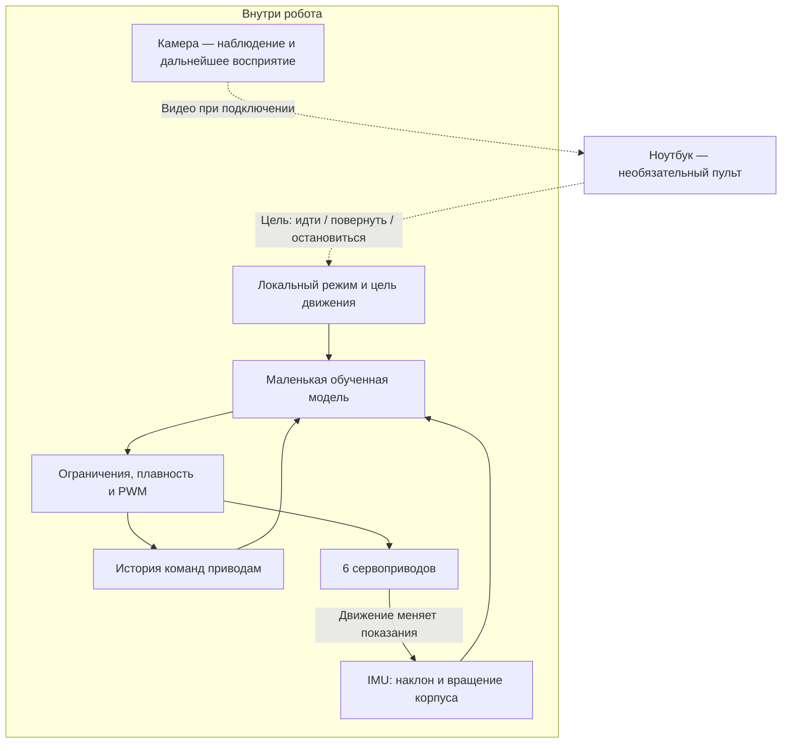

# Минимальная версия с локальной моделью управления

**Альтернативный шестисервовый вариант.** Актуальная основная версия около 40 см описана в [ROBOT_BASELINE.md](../../ROBOT_BASELINE.md). Этот документ сохраняет исследованный вариант локальной модели на микроконтроллере, а не текущую рекомендацию полной сборки.

Дата: 26 октября 2026. Требование локального исполнения модели сохраняется и для основной версии; аппаратная реализация в этом документе относится к более простой механике.

## Обязательное поведение

**Основной цикл движения и обученная модель исполняются в роботе.** Ноутбук может обучать модель, загружать прошивку, показывать камеру и передавать высокоуровневые команды. Работа двигательной модели не должна требовать непрерывной связи с ноутбуком или облаком.

В первой версии под моделью понимается небольшая **модель управления движением**, а не универсальная языковая/мультимодальная модель. Полноценное понимание сцены, свободный диалог и самостоятельная навигация по комнате не являются уже подтверждёнными возможностями этой конфигурации.

Камера не обязана отправлять изображение наружу для каждого шага. В этой конфигурации двигательная модель опирается на состояние корпуса и локальную цель; способ добавления локального зрительного поведения определяется отдельно и проверяется по ресурсам платы.

## Минимальная аппаратная основа

- **Одна XIAO ESP32-S3 Sense с камерой и антенной** — предварительный кандидат бортового вычислителя. По [Seeed](https://wiki.seeedstudio.com/xiao_esp32s3_getting_started/) это двухъядерный ESP32-S3 с PSRAM, камерой и Wi-Fi. Готовность конкретной модели нельзя вывести только из этих характеристик.
- **Один IMU GY-521 / MPU6050** — добавляется к прежнему списку: [Arduino54, 250 ₽](https://arduino54.ru/catalog/datchiki-sensory/polozheniya/akselerometr-i-giroskop-mpu6050/). Питание и подтяжки I²C согласовать с 3,3-вольтовой логикой. Датчик сам по себе не создаёт алгоритм балансировки.
- **Те же шесть приводов:** 2×FT1017M, 2×FT1190M, 2×FS90. Их механическая пригодность и комплектность качалок ещё проверяются.
- **Прежняя минимальная силовая часть:** аккумулятор, BMS, один кандидат UBEC5 В, размыкатель/защита и монтаж. Одновременную нагрузку камеры, модели и приводов проверяем измерением.

Вместо добавления Raspberry Pi заранее сначала проверяется малая модель на ESP32-S3. Если модель не укладывается в ресурсы или не обеспечивает нужного поведения, пересматривается **бортовой вычислитель и бюджет**. Постоянное вычисление двигательной модели на ноутбуке не считается выполнением требования.

## Что получает и выдаёт модель

Исходные кандидаты входов: оценки наклона/вращения из IMU, текущая цель движения, история заданных положений и предыдущих выходов. Точный вектор и необходимость фазы шага/дополнительного состояния определяются при обучении.

Выходы модели преобразуются на борту в ограниченные целевые положения приводов. Голова и ноги координируются локальной программой; точное разделение обязанностей модели и вспомогательных регуляторов фиксируется после симуляции и испытаний.

**У выбранных PWM-серв нет внешней телеметрии фактических углов.** История команд не заменяет измерения суставов. Поэтому чужую политику, ожидающую реальные позиции/скорости суставов, нельзя запускать с подставленными командами. Новую модель требуется обучать с теми наблюдениями, которые реально доступны. Если выяснится, что их недостаточно, придётся пересмотреть датчики или приводы.

## Запуск и обучение

1. Сначала идентифицируются механика и приводы на стенде, строится модель для симуляции.
2. Модель обучается/адаптируется на внешнем компьютере. Обучение снаружи не означает внешнее управление во время работы.
3. Веса и необходимая обработка входов экспортируются в формат бортового runtime. Для ESP32-S3 кандидат — [ESP-DL](https://github.com/espressif/esp-dl), поддерживающий квантованные модели и нужные базовые операции. Формат/операторы и качество после квантования нужно проверить.
4. Модель и параметры сохраняются во Flash робота. При включении плата загружает их и выполняет расчёт локально.
5. Подключённый ноутбук передаёт только разрешённые цели/команды и получает телеметрию. Камерный поток и сеть не должны блокировать двигательный цикл.

Ручной генератор поз и простая программируемая походка допускаются как испытательные инструменты. Они не подменяют итоговое требование наличия работающей обученной модели на борту.

## Режимы связи

- **Локальный режим:** бортовой сценарий задаёт цели; выполнение модели не зависит от Wi-Fi.
- **Управление с ноутбука:** ноутбук временно задаёт цель. Потеря команд обрабатывается локально — прекращаются новые перемещения и выполняется предусмотренная остановка. Это правило удалённого режима, а не запрет самостоятельной работы.
- **Обучение и отладка:** компьютер готовит веса, прошивку и диагностические данные; во время этого режима можно отдельно испытывать команды приводов на закреплённом стенде.

## Предварительные ресурсы

Сохраняются шесть PWM-выводов GPIO1/2/4/5/6/43. Для IMU предварительно выделяются D7/GPIO44 и D8/GPIO7 под отдельную шину I²C; microSD не используется. Шину камеры и IMU не инициализировать конфликтующими настройками. [ESP32-S3 имеет два I²C-контроллера](https://docs.espressif.com/projects/esp-idf/en/stable/esp32s3/api-reference/peripherals/i2c.html). Это распределение ресурсов, не проверенная разводка или прошивка.

Начальная цель двигательного цикла —50 Гц, то есть бюджет 20 мс. Это проектная цель, а не измеренная производительность. Нужно измерить полный цикл обработки датчика, вывода модели и команд приводам при работающих камере/Wi-Fi. Готовые политики Microduck с другой кинематикой и составом датчиков напрямую не применимы.

## Критерии готовности

- На плате исполняется реальная обученная модель; измерены память и время расчёта.
- Модель проверена с корректными реальными входами и после экспорта/квантования.
- Локальный сценарий движения выполняется с отключённым Wi-Fi на защищённом испытательном стенде.
- Ноутбук может задавать цель, но не требуется для каждого такта управления.
- Нагрузка камеры/сети не срывает двигательный цикл и питание.
- Устойчивость и полезность модели подтверждены на своей механике. Наличие нейросети без такого испытания не считается готовой походкой.

**Текущее состояние:** аппаратная архитектура и критерии определены; обученных весов, прошивки, симуляции и физического подтверждения этой походки пока нет.
