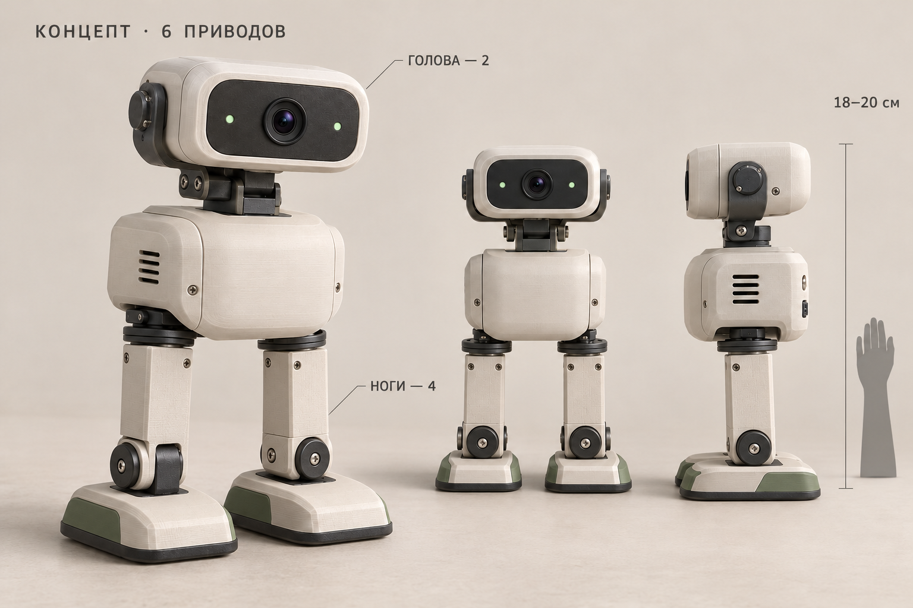

# Маленький двуногий AI-робот — концепция V1

**Актуальное упрощение:** первая версия ограничена ходьбой, подвижной головой, камерой и Wi-Fi. Новая рекомендуемая архитектура описана в [минимальной версии](../minimal/minimal-version.md): одна XIAO ESP32-S3 Sense с камерой вместо Pi+ESP32, шесть прежних приводов, один кандидат источника5В; звук, отдельные LED и дополнительные датчики отложены. Документ ниже сохраняет предыдущую расширенную концепцию.

**Закупочное уточнение 26.10.2026:** актуальная подборка находится в [списке закупки](../../procurement/shopping-list-2026-10-26.md). Вместо первоначальных MG90S рассматриваются 2×FT1017M для ступней, 2×FT1190M для поворота ног и 2×FS90 для головы. Ходьба/нагрузки не проверены. Реально найденная батарея850мАч тяжелее исходного резерва, размеры новых приводов отличаются; старая габаритная модель ниже не подтверждает размещение нового набора. Дешёвая доступная Pi Zero2W не найдена, поэтому прежнюю смету и bom.csv считать исходной оценкой, а не текущим списком для оплаты.

Дата: 26 октября 2026. Выбранный облик — основа дальнейшего проектирования. Это эскизный проект и предварительная спецификация, а не проверенный комплект для закупки и печати. CAD, симуляция и физические испытания ещё не проводились. Все размеры ниже — проектные цели.

## 1. Что собираем

Небольшой персонаж высотой около 18–20 см: округлый корпус, лёгкая голова с одной камерой и двумя индикаторами, два коротких прямых звена ног, широкие ступни. Шесть независимо управляемых осей: четыре для простой ходьбы, две для головы. Нет коленных суставов. Внешний корпус свой; исходная механическая идея — классический Otto. Цветные панели можно менять независимо от несущих деталей.

Планируемые навыки: стоять на ровной поверхности, делать короткие медленные шаги с переваливанием, поворачиваться серией шагов, оглядываться, кивать и выражать внимание движением головы, передавать изображение и звук внешнему AI. Ходьба с установленной камерой/Pi/аккумулятором требует проверки. Бег, лестницы, прыжки, автоматический подъём после падения и динамическая походка Microduck в V1 не заложены.

## 2. Шесть осей

Система координат: X — поперёк корпуса, Y — вперёд, Z — вверх. Направления положительного вращения будут зафиксированы при CAD/калибровке.

| Ось | Узел | Назначение | Кандидат |
|---|---|---|---|
| L_HIP_YAW | Левая нога у корпуса, ось Z | Разворачивает ногу и стопу в горизонтальной плоскости | MG90S |
| R_HIP_YAW | Правая нога у корпуса, ось Z | То же справа | MG90S |
| L_FOOT_ROLL | Левая ступня, ось Y | Наклоняет корпус/ступню вбок, помогает переносить вес | MG90S, тяга подлежит проверке |
| R_FOOT_ROLL | Правая ступня, ось Y | То же справа | MG90S, тяга подлежит проверке |
| HEAD_YAW | Основание шеи, ось Z | Поворот камеры влево/вправо | SG90 позиционный |
| HEAD_PITCH | Скоба головы, поперечная ось | Взгляд вверх/вниз | SG90 позиционный |

Это шесть приводов на весь робот, а не на каждую ногу. Ноги не сгибаются как человеческие: основа движения — согласованное покачивание и разворот стоп. Принцип четырёх приводов и исходные движения описаны в [Otto DIY](https://github.com/Open-Hardware-Leaders/OttoDIY) и [OttoDIYLib](https://github.com/OttoDIY/OttoDIYLib). Последняя библиотека ориентирована главным образом на Nano; перенос на выбранный ESP32 и неблокирующее выполнение движений — наша работа. GPL-3.0 у кода; дизайн Otto обозначен CC-BY-SA-4.0, при адаптации сохранять условия и атрибуцию.

## 3. Компоновка и размеры

| Параметр | Начальная цель |
|---|---|
| Общая высота | 192 мм в текущей габаритной модели |
| Корпус | примерно 84 × 58 × 60 мм |
| Голова | примерно 76 × 38 × 42 мм |
| Одна ступня | примерно 48 × 68 × 14 мм |
| Расстояние между центрами ног | примерно 58 мм |
| Расстояние от оси стопы до оси бедра | примерно 46 мм |
| Масса всего робота | желательно 250–300 г; пока расчётная цель |
| Начальные программные пределы головы | yaw ±45°, pitch ±20°; уточнить по шлейфу |

Размеры — внешние габариты оболочек; размеры сервоприводов, качалок, винтов и осей нужно будет согласовать отдельно. Они не являются деталировкой для печати.

Первичная габаритная компоновка сохранена в `layout.json`, редактируемые блоки OpenSCAD — в `layout.scad`, обзор спереди/сбоку — `assets/internal-layout.png`. Внутри условного корпуса с 2-мм стенками объёмные блоки электроники не пересекаются; несколько зазоров малы и не оставляют подтверждённого места под стойки/разъёмы. Это проверка прямоугольных объёмов, а не сборка точных моделей компонентов. Скрипт `make_layout.py` воспроизводит рисунок и проверку. OpenSCAD в этой среде не установлен: файл не компилировался его движком. Печатные детали не подготовлены.

В голове только камера, два LED и лёгкая оболочка. Ось наклона проходит близко к центру массы головы. Raspberry Pi крепится внутри корпуса, ориентировочно вертикально на задней стенке, с доступом к microSD и USB. ESP32 располагается на отдельной стойке, разъёмы доступны после снятия задней крышки. Аккумулятор находится низко и близко к середине между ногами, но не мешает вращению бёдер. IMU крепится к жёсткой раме корпуса. Усилитель/микрофон и динамик разносятся по возможности; микрофон механически отделяется от шумных приводов. CSI-шлейф проходит через свободную петлю у шеи и не служит ограничителем поворота.

Механика состоит из внутренней несущей рамы, двух поворотных узлов бёдер, двух прямых звеньев, двух наклоняемых ступней, двухосевой шеи и съёмных оболочек. Для головы и стоп предусмотреть пассивную опору с противоположной от привода стороны, чтобы не передавать всю боковую нагрузку на выходной вал. Тип подшипника и диаметр оси определяются после выбора конкретной сервы и качалки; покупать их по картинке рано.

Первый пластик — PLA для проверки формы, затем PETG для нагруженных креплений при необходимости; подошвы — тонкая резина либо TPU. Толщина стенок и рёбра подбираются по массе/жёсткости. Аккумулятор фиксируется ремешком/крышкой, не приклеивается намертво. Оставить вентиляцию Pi и доступ к выключателям.

## 4. Масса и выбор приводов

MG90S — предварительный бюджетный кандидат. Металлический редуктор не означает заметно больший момент: [TowerPro](https://towerpro.com.tw/product/mg90s-3/) указывает 13,4 г и 1,8 кгс·см при 4,8 В, причём это момент блокировки, не длительная рабочая нагрузка. Характеристики безымянных клонов могут отличаться.

Ориентировочный массовый бюджет: четыре MG90S 53,6 г; две SG90 18 г; Pi 11 г; камера 3 г; ESP32 10 г; преобразователи 28 г; аккумулятор 40 г; печать 85 г; крепёж/опоры 15 г; проводка 15 г; аудио 6 г; IMU 2 г; подошвы 5 г. Итого **291,6 г**. Только массы серв из паспортов; остальные значения — резервы, которые нужно заменить взвешиванием выбранных компонентов и массами CAD. Некоторым сборкам потребуется более тяжёлая батарея/электроника, поэтому цель 300 г не подтверждена.

Простая проверка: при массе 0,30 кг и плече нагрузки 3 см статический момент составляет 0,90 кгс·см (около 0,088 Н·м). Это уже половина паспортного момента блокировки MG90S; ускорения увеличат требования. Для рабочей конструкции сравнивают требуемый момент с длительно допустимым/проверенным в испытании, учитывают скорость, нагрев, люфт и реальное напряжение. Такая оценка не доказывает способность ходить.

Поэтому до покупки всех шести приводов: собрать одну опорную ногу на двух кандидатах, нагрузить балластом, соответствующим будущей массе и центру тяжести, измерить ток, удержание, просадку и нагрев. Затем на четырёх приводах проверить перенос веса с балластом головы/Pi. Если запаса недостаточно — облегчить и укоротить конструкцию либо заменить приводы стоп/ног, сохранив облик. Есть более сильные микро-PWM-приводы, например [Feetech FT-1190-C001 3,5 кгс·см при 6 В](https://www.feetechrc.com/products/small-steering-gear-page-3), но цена, доступность, крепления и работа на 5 В пока не проверены: прямой заменой его не считаем.

## 5. Электроника и связь

**Raspberry Pi Zero 2 W**, не Zero W первого поколения, работает с камерой, аудио и Wi-Fi. Большая мультимодальная модель находится на существующем внешнем компьютере/сервере. 512 МБ памяти Pi достаточно рассматривать для лёгкого шлюза камеры/API, но конкретный стек/частоту передачи предстоит измерить. Не планировать запуск большой VLM на Pi. [Спецификация Pi](https://www.raspberrypi.com/products/raspberry-pi-zero-2-w/).

**ESP32-WROOM DevKit** отвечает за шесть PWM-каналов, плавное движение, IMU, мониторинг батареи и локальный таймаут команд. Pi и ESP32 связываются UART с логикой 3,3 В и общим GND. Точные пины и схема подключения будут в электрическом проекте после фиксации ревизий плат. Отдельный PCA9685 для шести каналов не обязателен. Силовой ток серв не идёт через GPIO или регулятор ESP32.

Камера: **Raspberry Pi Camera Module 2 / IMX219**, один модуль. Для Pi Zero нужен отдельный кабель 22-pin mini CSI → 15-pin, не обычный шлейф из комплекта камеры. Кабель выбирается после трассировки шеи, исходно рассмотреть 15–20 см. [Документация камеры](https://www.raspberrypi.com/products/camera-module-v2/). Модуль с похожим сенсором для Jetson не покупать автоматически как совместимый с Pi.

IMU: один GY-521/MPU6050 для недорогого прототипа; проверять напряжение питания и подтяжки I²C конкретной платы, логика ESP32 должна остаться 3,3 В. Назначение — наклон/движение корпуса и обнаружение падения. Один датчик сам по себе не обеспечивает балансировку. Для долговременного изделия можно позже выбрать современный IMU; V1 использует доступный прототипный модуль.

Аудио: один INMP441 I²S либо SPH0645 с соответствующим драйвером; один MAX98357A и один небольшой динамик 4 Ом / 3 Вт. Их работа в общем I²S-конфиге Pi требует проверки драйвера и формата аудио; это не обещание plug-and-play. Два обычных LED с резисторами дают световые реакции без массы дисплея. ToF-датчик VL53L0X перед корпусом — опция после первых опытов, в основной бюджет не включён.

## 6. Питание

Исходная архитектура: лёгкий **2S LiPo 650–850 мА·ч**; номинально 7,4 В, после полного заряда 8,4 В. Окончательную модель выбирать по габаритам, массе, допустимому току и разъёмам. Ёмкость сама по себе не задаёт токоотдачу.

От батареи идут две независимые понижающие линии с общим GND:

1. Приводы: регулируемый UBEC с настоящими 5 А длительно, установленный на **5,0 В**. Кандидат [Hobbywing UBEC 5A AIR](https://www.hobbywing.com/products/ubec-5a93). Шесть серв соединяются с силовой распределительной колодкой; ток не проходит через макетную плату.
2. Pi и ESP32: отдельный 5 В преобразователь на 2–3 А, например подходящий UBEC 3A, если подтверждены стабильность и диапазон входа для 2S. Вход и выход преобразователей не соединять в обход. Положительные выходы двух 5 В линий не объединять.

Предусмотреть основной выключатель, отдельное отключение линии приводов, предохранитель, доступный балансировочный разъём аккумулятора и подходящую **аппаратную защиту 2S с контролем напряжения каждой ячейки и отключением всей нагрузки**. Её ток и сопротивление должны соответствовать пиковым нагрузкам робота; это входит в резерв силовых мелочей. Программная остановка движения не защищает батарею полностью: Pi/ESP32 продолжают потреблять энергию. Нужна ранняя команда корректного завершения работы Pi и последующее отключение питания; аппаратная защита служит последним пределом. Один делитель общего напряжения не заменяет контроль каждой ячейки. Зарядник — для **2S LiPo с балансировкой**, с включённым в смету сетевым БП. TP4056 для одной ячейки этому аккумулятору не подходит. На первом стенде аккумулятор/зарядник не нужны: используем проверенный внешний 5 В БП.

Время работы пока не заявляем: его можно оценить только после измерения мощности на стоянии/ходьбе/передаче видео. Маркировка «5 А» на неизвестном DC-DC недостаточна без тепловой и электрической проверки.

## 7. Программное управление

Предлагаемая цепочка: камера/микрофон → Pi → Wi-Fi → внешний AI → ограниченная команда действия → Pi → ESP32 → локальная последовательность движения → PWM-сервы. IMU/напряжение возвращают телеметрию через ESP32. Баланс и срочная реакция не должны зависеть от задержки внешней модели.

Начальный API: `move_forward(steps=1)`, `turn(direction, steps=1)`, `look_at(yaw_deg, pitch_deg)`, `pose(name)`, `stop()`, `get_state()`. `look_at` на этом уровне означает углы головы; перевод пикселя камеры/цели мира в углы — отдельная задача. Команды ограничены по углам, скорости и длительности; таймаут связи выполняется локально. Остановка движения и отключение момента — разные операции. Плавные траектории и небольшой конечный автомат нужны прежде обучения. Готовой RL-policy для этой новой шестисервовой конструкции нет; обученные политики Open Duck/Microduck к ней не подходят.

## 8. Полный бюджет

В [bom.csv](bom.csv) 19 позиций с количеством, ценой за единицу, источником и статусом: `observed` — увиденная цена карточки/каталога, `allowance` — инженерный резерв, не проверенная корзина. Цены на 26.10.2026 по доступным страницам/индексу; наличие и стоимость доставки в РФ не подтверждены оформлением заказа.

| Группа | RUB |
|---|---:|
| 4 MG90S + 2 SG90 | 1 360 |
| Pi Zero 2 W + ESP32 | 7 760 |
| Камера + Zero-шлейф + microSD | 3 400–5 600 |
| IMU + микрофон + усилитель + динамик + LED | 810–1 380 |
| Аккумулятор + 2 преобразователя + зарядник/БП + силовые мелочи | 4 800–9 300 |
| Печать + крепёж/опоры/подошвы | 2 200–4 500 |
| **Итого** | **20 330–29 900** |

Плановый бюджет с 20% резервом на итерации: **24 396–35 880 ₽**, без доставки, инструментов, нового компьютера, AI API и стоимости разработки. Это вариант с покупкой Pi по найденной российской цене 7 290 ₽ в [Amperka](https://amperka.ru/collection/promo), а не пересчёт международного MSRP $15. Более выгодный проверенный лот в Китае уменьшит бюджет на разницу фактических цен; фиксированную «цену AliExpress» не обещаем. Если потребуются более сильные сервоприводы, бюджет пересчитывается.

Нужные инструменты: паяльник и припой, мультиметр, небольшие отвёртки/ключи, бокорезы и штангенциркуль. Если их нет, заложить ориентировочно ещё 3–6 тыс. ₽; это оценка, не проверенная корзина. Собственный 3D-принтер не обязателен: в смете есть резерв на заказную печать, который уточняется по готовым моделям.

Проверенные опоры: MG90S 250 ₽, SG90 180 ₽ в [Arduino54](https://arduino54.ru/category/mehanika/servoprivody/); ESP32 470 ₽ в [duino.ru](https://duino.ru/esp32-wifi-bluetooth-type-c-ch340-mikrokontroller/); GY-521 250 ₽ в каталоге [Arduino54](https://arduino54.ru/catalog/istochniki-pitaniya/bloki-pitaniya/blok-pitaniya-5v-3a-eu-vilka/) как сопутствующий товар. Остальные суммы, включая аккумулятор и печать, требуют выбора конкретных моделей и котировок.

## 9. Поэтапная сборка без большой первой закупки

1. **Сначала виртуальная компоновка.** FreeCAD для собственного локального CAD; габаритные модели шести приводов, плат, батареи, шлейфа и опор. Проверяем пересечения и массу. Затем MuJoCo: правильные оси, массы/инерции, лимиты приводов, контакты стоп. Загруженный STL сам по себе не является физической моделью. Симулятор полезен, но не подтверждает характеристики дешёвых серв без измерений.
2. **Одна нога на стенде:** 2 MG90S 500 ₽ + ESP32 470 ₽ + 5 В / 3 А БП 350 ₽ + крепление/проводка 400–800 ₽ = **1 720–2 120 ₽**, без доставки. Используем имеющийся ноутбук; проверяем нагрузки до выбора окончательных моторов. При отсутствии инструментов их стоимость отдельная.
3. **Четырёхсервовое основание с балластом.** Проверка простых шагов и поворотов при проектной массе. Внешнюю оболочку/балласт можно временно напечатать упрощёнными. Это обязательная проверка переносимости механики Otto на новую нагрузку.
4. **Голова, затем камера/Pi/аудио/батарея.** По одному добавляем нагрузку и питание, повторяем проверку походки. Затем подключаем сетевой API и внешний AI. В полном бюджете уже учтены повторно используемые компоненты, не надо складывать стоимость всех стадий как независимых роботов.

Критерий до фиксации CAD для печати: выбран точный привод и проверен нагруженный узел. Критерий до покупки Pi/полной батареи: основание ходит с эквивалентным балластом. Таким образом понравившийся внешний вид сохраняется, а выбор силовой части опирается на измерения.
