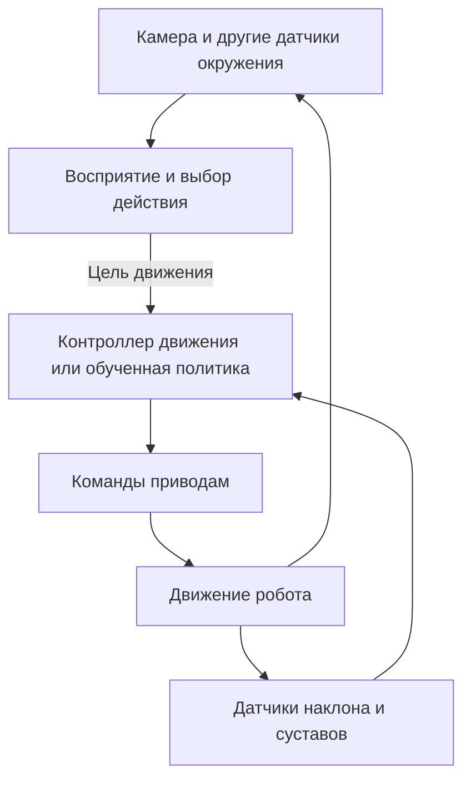

# Датчики, команды и обученное движение

Дата проверки источников: 26 октября 2026.

## Общий принцип

Программа получает измерения датчиков и заданную цель, вычисляет команды исполнительным механизмам, затем снова читает датчики. Это цикл обратной связи. Преобразование измерений в команды может состоять из обычных алгоритмов управления, обученных моделей или их сочетания.

Удобно различать уровни:

1. **Восприятие:** камера помогает найти человека или предмет; датчики наклона и суставов описывают состояние самого робота.
2. **Выбор действия:** человек, сценарий или AI задаёт намерение — идти с некоторой скоростью, повернуться, посмотреть в сторону, сесть.
3. **Управление движением:** алгоритм или обученная политика рассчитывает команды суставам с учётом состояния робота.
4. **Приводы:** встроенные регуляторы сервоприводов исполняют заданные положения в пределах своих возможностей.

Это распространённая схема объяснения, но не универсальная архитектура каждого робота. Например, управление движением бывает программным генератором траекторий, кинематическим/динамическим регулятором либо нейросетью. Некоторые обученные системы объединяют несколько уровней.

## Что подтверждено у Microduck

У Microduck доступен набор навыков и API управления. Команды верхнего уровня не обязательно приходят от большой модели, смотрящей на камеру: источником может быть геймпад или программа. Архитектура также предусматривает интеграцию внешнего AI. Наличие обученных движений само по себе не означает наличие штатной универсальной VLM, принимающей все решения.

Его двигательные навыки используют **обученные политики**, а не только фиксированные анимации. Политика получает состояние робота и команду движения, после чего формирует выходные значения для суставов. Расчёт повторяется на борту с частотой 50 Гц; реакции могут меняться в зависимости от измерений. Документированный контракт политики включает данные о собственном состоянии и команды; изображение камеры не является непосредственным входом описанной политики ходьбы.

Обучение проходит в симуляции; подготовленная модель экспортируется в ONNX и запускается бортовым runtime. В документации есть разные политики ходьбы и специальных навыков. Верхний уровень может выбирать навык, а выполнение внутри навыка остаётся обученным управлением с обратной связью.

Источники:

- [Microduck: README и бортовой цикл](https://github.com/pollen-robotics/microduck)
- [Архитектура: намерения, моторный цикл и восприятие](https://github.com/pollen-robotics/microduck/blob/main/docs/design/architecture.md)
- [Microduck RL: обучение, входы политики и экспорт](https://github.com/pollen-robotics/microduck_rl)

## Что заложено в собственную минимальную версию

Первый вариант планируется с локальной программируемой походкой. Плата должна сама выполнять согласованные движения шести приводов; внешнему компьютеру достаточно отправлять команды действий. Заранее записанный сценарий движения может работать без сети.

Серверный AI нужен для более сложного понимания изображения и выбора действий, если такие функции включены. Каждое положение мотора не должно зависеть от ответа сервера.

Готовая обученная политика для собственной шестисервовой механики пока не создана. Модели Microduck/Open Duck не переносятся напрямую на другую кинематику и другие приводы. Маленькая нейросеть на ESP32-S3 технически возможна, но подходящую модель потребуется обучить/адаптировать, а скорость, память, датчики и поведение проверить. [ESP-DL](https://github.com/espressif/esp-dl) подтверждает возможность локального нейросетевого вывода на поддерживаемых ESP-чипах, а не готовность конкретной походки.
